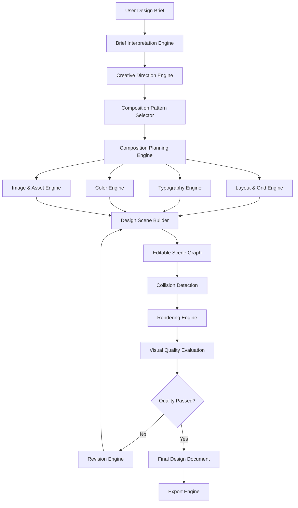
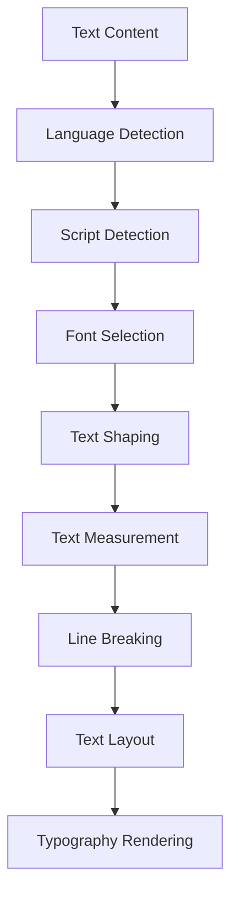

# Professional Graphic Design Engine — Technical Architecture & Implementation Specification

> **Mission:** Build a professional, deterministic, vector-based design engine that transforms creative design concepts into sophisticated, editable, production-quality graphic compositions.
>
> The engine must combine computational layout, typography intelligence, vector construction, image processing, visual hierarchy, and automated design evaluation.
>
> It must support the type of creative output expected from experienced professional graphic designers using tools such as Adobe Illustrator and other professional design applications.

---

# 1. Design Engine Philosophy

The Design Engine is the core visual construction system of the platform.

Its responsibility is to convert a structured creative plan into an actual graphic composition.

The engine must not depend on randomly positioning text, shapes, images, and decorative elements.

It must understand the relationships between design elements and construct compositions using deliberate visual logic.

## 1.1 Core Principle

**Creative Intelligence decides what to create. The Design Engine decides how to construct it. The Rendering Engine decides how it appears. The Quality Engine decides whether it is good enough.**

The system must separate creative reasoning from deterministic construction.

| System | Responsibility |
|---|---|
| AI Creative Intelligence | Understand the brief and develop concepts |
| Art Direction Engine | Define visual direction and style |
| Composition Planner | Create a structured composition plan |
| Layout Engine | Calculate element positions and dimensions |
| Typography Engine | Measure and arrange text |
| Vector Engine | Construct shapes, paths, and graphics |
| Image Engine | Process, crop, mask, and position images |
| Scene Graph | Maintain editable design objects |
| Rendering Engine | Render the final visual composition |
| Collision Engine | Detect overlapping and layout problems |
| Design Critic | Evaluate visual quality |
| Revision Engine | Improve weak design areas |
| Export Engine | Produce final output files |

## 1.2 Non-Negotiable Requirements

The engine must:

1. Produce editable design documents.
2. Support original compositions rather than fixed templates.
3. Use mathematical layout calculations.
4. Maintain consistent visual hierarchy.
5. Support sophisticated typography.
6. Support vector and raster elements.
7. Detect unwanted overlaps.
8. Preserve object relationships.
9. Support multilingual text rendering.
10. Allow non-destructive editing.
11. Produce reliable rendering results.
12. Support high-resolution export.

---

# 2. Overall Design Engine Architecture

The design-generation pipeline should follow this architecture:



Each stage should have a clearly defined input and output.

The system must avoid creating one monolithic AI-generated layout function.

---

# 3. Design Document Data Architecture

Every design must be represented by a structured document.

The design document is the source of truth for the editor, renderer, and export system.

## 3.1 Core Design Document

Example TypeScript structure:

```ts
interface DesignDocument {
  id: string;
  name: string;
  version: number;

  metadata: {
    category: string;
    description?: string;
    createdAt: string;
    updatedAt: string;
  };

  canvas: CanvasConfig;

  designTokens: DesignTokens;

  artDirection: ArtDirection;

  composition: CompositionPlan;

  elements: DesignElement[];

  assets: DesignAsset[];

  guides: DesignGuide[];

  settings: DesignSettings;
}
```

## 3.2 Canvas Configuration

```ts
interface CanvasConfig {
  width: number;
  height: number;

  unit: "px" | "mm" | "cm" | "in";

  background: {
    type: "solid" | "gradient" | "image" | "transparent";
    value?: string;
  };

  dpi?: number;

  bleed?: {
    top: number;
    right: number;
    bottom: number;
    left: number;
  };

  safeArea?: {
    top: number;
    right: number;
    bottom: number;
    left: number;
  };
}
```

The canvas system must distinguish between:

- Internal rendering dimensions
- Display dimensions
- Physical print dimensions
- Export dimensions

Never confuse screen pixels with physical print measurements.

## 3.3 Design Tokens

```ts
interface DesignTokens {
  colors: Record<string, string>;

  typography: {
    display: TypographyToken;
    heading: TypographyToken;
    subheading: TypographyToken;
    body: TypographyToken;
    caption: TypographyToken;
  };

  spacing: Record<string, number>;

  radii: Record<string, number>;

  shadows: Record<string, ShadowToken>;
}
```

Design tokens should make consistent styling easier without forcing every design to look identical.

---

# 4. Brief Interpretation Engine

The engine must convert unstructured user instructions into a structured design brief.

## 4.1 Input

Example:

> "Create a premium admission poster for an academic coaching center. Include the institution name, admission announcement, class information, contact number, and a registration CTA."

## 4.2 Structured Output

```ts
interface DesignBrief {
  category: string;

  objective: string;

  audience: string[];

  brand: {
    name?: string;
    identity?: string;
    colors?: string[];
  };

  content: {
    headline: string;
    subheadline?: string;
    body: string[];
    details: string[];
    cta?: string;
  };

  visualDirection: {
    mood: string[];
    style: string[];
    preferredColors?: string[];
    imageDirection?: string;
  };

  requirements: {
    width: number;
    height: number;
    language: string[];
    outputFormats: string[];
  };
}
```

## 4.3 Content Classification

Classify content into:

- Primary headline
- Secondary headline
- Supporting statement
- Main body
- Important information
- Date and time
- Location
- Price
- CTA
- Brand information
- Contact information
- Legal or mandatory information

The classification engine must preserve the original meaning and exact factual information.

Do not invent names, dates, prices, phone numbers, or institutional details.

## 4.4 Content Importance

Assign an initial importance level.

| Priority | Content type |
|---|---|
| Critical | Main message or primary headline |
| High | Main offer, event, product, or subject |
| Medium | Supporting information |
| Low | Additional details |
| Contextual | Branding, captions, legal information |

These are starting priorities, not fixed rules. The design objective may require different hierarchy decisions.

---

# 5. Creative Direction Engine

The Creative Direction Engine determines the visual personality of the design.

It must define:

- Art direction
- Visual mood
- Color philosophy
- Typography direction
- Image style
- Shape language
- Composition density
- Visual rhythm
- Level of complexity

## 5.1 Art Direction Schema

```ts
interface ArtDirection {
  style: string;

  mood: string[];

  colorStrategy: string;

  typographyStrategy: string;

  imageStrategy: string;

  shapeLanguage: string;

  visualDensity: "minimal" | "balanced" | "dense";

  complexity: "low" | "medium" | "high";

  references?: string[];
}
```

## 5.2 Creative Direction Rules

Do not select styles randomly.

A luxury business card, educational poster, sports advertisement, and magazine cover require different visual strategies.

The selected direction must support the communication objective.

Consult `DESIGN_SYSTEM.md` and `DESIGN_PATTERNS_LIBRARY.md`.

---

# 6. Composition Planning Engine

This engine determines the overall structure before individual elements are constructed.

## 6.1 Composition Plan

```ts
interface CompositionPlan {
  primaryPattern: string;

  supportingPatterns: string[];

  focalPoint: {
    x: number;
    y: number;
    strength: number;
  };

  readingFlow: "ltr" | "rtl" | "vertical" | "custom";

  hierarchy: HierarchyItem[];

  zones: CompositionZone[];

  grid: GridConfiguration;

  constraints: CompositionConstraints;
}
```

## 6.2 Composition Zones

Divide the canvas into meaningful areas.

Possible zones:

- Header
- Brand area
- Hero area
- Headline area
- Supporting content
- Information section
- Image section
- CTA section
- Footer

Zones must be dynamic.

Not every design requires every zone.

The engine must be able to use overlapping or irregular zones when the art direction requires them.

## 6.3 Focal Point Calculation

The focal point determines where viewers are initially encouraged to look.

Potential focal-point indicators:

- Element size
- Contrast
- Position
- Color intensity
- Image saliency
- Typography weight
- Isolation
- Directional emphasis

The engine should combine these signals instead of relying on position alone.

## 6.4 Reading Flow

Reading flow must consider:

- Language direction
- Content hierarchy
- Element alignment
- Image gaze
- Directional shapes
- Visual contrast
- Information sequence

For mixed-language designs, individual text elements must preserve their own writing direction.

---

# 7. Layout and Grid Engine

The Layout Engine calculates the positions and dimensions of design elements.

It must not rely on arbitrary hardcoded coordinates for every design.

## 7.1 Supported Grid Systems

Implement:

- Column grids
- Modular grids
- Baseline grids
- Asymmetric grids
- Hierarchical grids
- Golden-ratio-inspired divisions
- Rule-of-thirds guides
- Custom grids

## 7.2 Grid Configuration

```ts
interface GridConfiguration {
  type:
    | "column"
    | "modular"
    | "baseline"
    | "asymmetric"
    | "custom";

  columns: number;

  rows?: number;

  gutter: number;

  margin: {
    top: number;
    right: number;
    bottom: number;
    left: number;
  };

  baseline?: number;

  enabled: boolean;
}
```

## 7.3 Layout Constraints

Each element may have:

- Minimum width
- Maximum width
- Minimum height
- Maximum height
- Preferred position
- Alignment
- Aspect ratio
- Spacing requirement
- Priority
- Parent relationship
- Allowed overlap

## 7.4 Layout Calculation

The engine should calculate positions through a combination of:

1. Canvas constraints
2. Composition zones
3. Grid alignment
4. Content dimensions
5. Element importance
6. Visual balance
7. Spacing rules
8. Collision detection

A conceptual position model:

```ts
interface LayoutElement {
  id: string;

  preferredX: number;
  preferredY: number;

  preferredWidth: number;
  preferredHeight: number;

  minWidth?: number;
  maxWidth?: number;

  minHeight?: number;
  maxHeight?: number;

  priority: number;

  locked?: boolean;

  allowedOverlap?: string[];
}
```

The engine should preserve preferred positions unless a constraint or quality improvement justifies adjustment.

## 7.5 Layout Optimization

Use a constraint-based approach.

Possible methods:

- Rule-based positioning
- Constraint solving
- Weighted optimization
- Grid snapping
- Collision penalties
- Alignment scoring
- Spacing optimization

Do not introduce a complex optimization dependency unless it solves a real problem.

Start with deterministic, testable layout rules and add more advanced optimization incrementally.

---

# 8. Spacing and Visual Balance Engine

Spacing is an essential part of professional composition.

## 8.1 Spacing System

Use a configurable spacing scale.

Example:

```ts
const spacingScale = {
  xs: 4,
  sm: 8,
  md: 16,
  lg: 24,
  xl: 32,
  "2xl": 48,
  "3xl": 64,
  "4xl": 96
};
```

The values are starting tokens, not mandatory spacing for every design.

## 8.2 Spacing Rules

The engine must evaluate:

- Distance between related elements
- Distance between unrelated groups
- Headline-to-subheadline spacing
- Image-to-text spacing
- Section separation
- Canvas edge margins
- Internal padding
- Alignment consistency

Related content should usually have closer spacing than unrelated content.

## 8.3 Visual Balance

Balance can be:

- Symmetrical
- Asymmetrical
- Radial
- Optical
- Directional
- Dynamic

Do not assume equal dimensions create visual balance.

The engine should consider:

- Visual mass
- Contrast
- Element size
- Color intensity
- Image complexity
- Position
- Negative space

---

# 9. Typography Engine

Typography must be treated as a major design subsystem.

It must measure text before final positioning.

## 9.1 Typography Pipeline



## 9.2 Typography Schema

```ts
interface TypographyToken {
  fontFamily: string;

  fontSize: number;

  fontWeight: number | string;

  lineHeight: number;

  letterSpacing: number;

  textTransform?: string;

  textAlign?: "left" | "center" | "right" | "justify";
}
```

## 9.3 Text Measurement

Before rendering, determine:

- Actual text width
- Actual text height
- Line count
- Baseline positions
- Line height
- Font metrics
- Available width
- Available height
- Overflow

Use a suitable text measurement and shaping system.

Do not estimate text dimensions from character count alone.

## 9.4 Text Fitting

When text exceeds the available space, use this priority:

1. Recalculate line breaks.
2. Adjust text container dimensions within constraints.
3. Adjust line spacing carefully.
4. Select a suitable font weight or width variant.
5. Reduce font size within acceptable limits.
6. Reconsider the composition zone.

Never silently remove important text.

Do not shrink all text until it becomes unreadable.

## 9.5 Font Selection

The font engine should support:

- Local fonts
- Uploaded fonts
- Web fonts
- Font fallback
- Font metadata
- Font weight mapping
- Script coverage detection

## 9.6 Multilingual Typography

Support:

- English
- Bengali
- Arabic
- Urdu
- Mixed-language text

Important technical requirements:

- Unicode correctness
- Complex script shaping
- OpenType features
- Ligatures
- Bidirectional text
- Right-to-left layout
- Script-specific line breaking
- Proper fallback fonts

Use a suitable shaping engine when necessary, such as HarfBuzz, or a browser rendering environment with verified complex-script support.

Do not manually reverse Arabic or Bengali strings to simulate correct rendering.

## 9.7 Typography Hierarchy

Create a visual relationship between:

- Display
- Headline
- Subheadline
- Section title
- Body
- Caption
- Label
- CTA

Use controlled scale, weight, contrast, and spacing.

---

# 10. Color Engine

The Color Engine creates and validates color systems.

## 10.1 Color Palette Generation

A palette may contain:

- Primary
- Secondary
- Accent
- Background
- Surface
- Text
- Muted
- Border
- Highlight

## 10.2 Color Strategy

Possible strategies:

- Monochromatic
- Analogous
- Complementary
- Split complementary
- Triadic
- Tetradic
- Neutral with accent
- Brand-driven
- Image-derived

## 10.3 Color Evaluation

Evaluate:

- Contrast
- Readability
- Visual hierarchy
- Color harmony
- Saturation balance
- Background compatibility
- Brand consistency

## 10.4 Gradient Engine

Support:

- Linear gradients
- Radial gradients
- Multiple color stops
- Stop positions
- Transparency
- Angle
- Gradient transforms
- Mesh gradients where technically supported

A gradient must be an intentional design decision.

Do not automatically add gradients to every background.

---

# 11. Vector Construction Engine

The Vector Engine constructs editable graphic elements.

## 11.1 Supported Primitives

At minimum:

- Rectangle
- Rounded rectangle
- Circle
- Ellipse
- Line
- Polygon
- Polyline
- Path
- Custom shape
- Text
- Group

## 11.2 Vector Properties

Each object may support:

- Fill
- Stroke
- Stroke width
- Opacity
- Rotation
- Transform
- Clipping
- Masking
- Shadow
- Gradient
- Blend mode
- Filters

## 11.3 Path Construction

Support:

- Move
- Line
- Cubic Bézier
- Quadratic Bézier
- Arc
- Close path

## 11.4 SVG Output

SVG should be used as an important vector rendering format.

The engine must:

- Generate valid SVG.
- Use consistent coordinate systems.
- Preserve object hierarchy.
- Avoid malformed paths.
- Use appropriate clipping and masks.
- Handle gradients and filters safely.
- Preserve text where possible.
- Avoid unnecessary path complexity.

## 11.5 Vector Editing

Where supported, users should be able to:

- Select paths
- Modify shape properties
- Resize objects
- Rotate objects
- Change colors
- Edit strokes
- Group objects
- Ungroup objects
- Change layer order

---

# 12. Image Processing Engine

The Image Engine handles raster images and generated visual assets.

## 12.1 Image Operations

Support:

- Import
- Resize
- Crop
- Rotate
- Position
- Mask
- Clip
- Background removal
- Color correction
- Brightness
- Contrast
- Saturation
- Blur
- Shadow
- Overlay
- Blend modes

## 12.2 Image Placement

The engine must determine:

- Subject position
- Crop region
- Aspect ratio
- Focal area
- Text-safe areas
- Visual compatibility
- Image resolution

## 12.3 Image-to-Vector Strategy

Do not assume every image can be perfectly converted into vector artwork.

Use different strategies according to image type.

| Image type | Recommended approach |
|---|---|
| Simple geometric diagram | Reconstruct with vector primitives |
| Mathematical figure | Use precise paths and geometry |
| Chart | Use structured chart objects |
| Logo | Use original vector source where available |
| Complex photograph | Preserve as raster image |
| Simple icon | Use vector paths |
| Hand-drawn illustration | Use tracing or manual vector reconstruction |
| Detailed artwork | Preserve image or use suitable illustration reconstruction |

The engine must not claim perfect vector reconstruction when the result is only an approximation.

## 12.4 Image Quality

Check:

- Resolution
- Sharpness
- Aspect ratio
- Crop accuracy
- Subject visibility
- Transparency
- Color consistency

---

# 13. Scene Graph Engine

The Scene Graph is the central representation of all editable design elements.

It must support hierarchical relationships.

## 13.1 Scene Graph Structure

```ts
interface SceneNode {
  id: string;

  type:
    | "text"
    | "shape"
    | "path"
    | "image"
    | "group";

  name: string;

  transform: {
    x: number;
    y: number;
    scaleX: number;
    scaleY: number;
    rotation: number;
  };

  style?: Record<string, unknown>;

  visible: boolean;

  locked: boolean;

  children?: SceneNode[];

  metadata?: Record<string, unknown>;
}
```

## 13.2 Parent-Child Relationships

Groups must preserve their children.

Moving a parent should correctly transform its children.

Ungrouping must preserve the children's world positions and visual appearance.

## 13.3 Z-Order

Maintain explicit rendering order.

Support:

- Bring to front
- Send to back
- Bring forward
- Send backward

The renderer must respect the scene graph's stacking order.

## 13.4 Non-Destructive Editing

Prefer storing transformations and editable properties rather than permanently altering original source assets.

Maintain original asset references when possible.

---

# 14. Collision Detection Engine

The Collision Engine identifies unwanted overlaps and layout conflicts.

## 14.1 Types of Collision

Detect:

- Text-to-text overlap
- Text-to-image overlap
- Shape-to-text overlap
- Object-to-canvas overflow
- Image-to-image collision
- Element-to-safe-area conflict
- Unintended clipping

## 14.2 Allowed Overlap

Not every overlap is a design error.

Intentional overlap may be used for:

- Layered compositions
- Text over photography
- Cutout subjects
- Typography masks
- Decorative frames
- Depth effects

Each element should be able to declare allowed relationships.

## 14.3 Collision Detection Methods

Use appropriate geometric methods:

- Axis-aligned bounding boxes
- Oriented bounding boxes
- Polygon intersection
- Path bounds
- Text bounds
- Clipping region analysis

For text, use actual rendered or measured bounds where possible.

## 14.4 Collision Response

When an unwanted collision occurs:

1. Identify the conflicting objects.
2. Determine their importance.
3. Check whether overlap is intentional.
4. Evaluate alternative positions.
5. Preserve alignment and hierarchy.
6. Recalculate spacing.
7. Validate the result.

Never automatically move a critical headline simply because it intersects an intentionally layered image.

## 14.5 Collision Severity

| Severity | Meaning |
|---|---|
| Critical | Important text is unreadable or essential content is clipped |
| High | Major unintended overlap |
| Medium | Spacing or alignment problem |
| Low | Minor visual collision |

---

# 15. Visual Hierarchy Engine

The hierarchy engine ensures that important content receives appropriate visual emphasis.

## 15.1 Hierarchy Signals

Evaluate:

- Size
- Weight
- Contrast
- Color
- Position
- Isolation
- Image complexity
- Shape
- Spacing
- Repetition

## 15.2 Hierarchy Rules

The primary message should generally receive stronger emphasis than supporting content.

However, the exact visual order depends on the communication objective.

Do not assume the headline must always be the largest element.

For example:

- Product advertisements may prioritize the product.
- Event posters may prioritize the event name.
- Sales graphics may prioritize the offer.
- Speaker posters may prioritize the portrait.
- Educational graphics may prioritize a key concept.

---

# 16. Layer and Depth Engine

The engine should create controlled visual depth.

## 16.1 Depth Layers

Possible layers:

1. Background
2. Background texture
3. Decorative environment
4. Main image
5. Supporting graphics
6. Foreground objects
7. Primary typography
8. Secondary information
9. CTA
10. Final highlights

This is a conceptual model, not a mandatory stacking order for every design.

## 16.2 Depth Techniques

Support:

- Shadow
- Blur
- Opacity
- Overlap
- Perspective
- Scale contrast
- Lighting
- Color separation
- Layered surfaces

## 16.3 Lighting Consistency

When multiple objects use shadows or lighting:

- Maintain a consistent light direction.
- Use believable shadow softness.
- Avoid conflicting light sources unless intentional.
- Keep effects proportional to object scale.

---

# 17. Composition Optimization Engine

The engine must refine the composition using measurable design constraints.

## 17.1 Optimization Objectives

Potential objectives:

- Improve hierarchy.
- Improve balance.
- Improve alignment.
- Improve spacing.
- Reduce unwanted collisions.
- Improve text readability.
- Preserve focal point clarity.
- Improve negative-space distribution.
- Maintain visual rhythm.

## 17.2 Weighted Optimization

An abstract optimization score may be represented as:

```ts
interface LayoutScore {
  hierarchy: number;

  alignment: number;

  spacing: number;

  balance: number;

  readability: number;

  collisionPenalty: number;

  overflowPenalty: number;

  visualConsistency: number;
}
```

The system should use weighted scoring based on the design category.

Do not treat one universal mathematical formula as a replacement for visual judgment.

## 17.3 Deterministic Layout

Given the same:

- Design brief
- Composition plan
- Design tokens
- Assets
- Canvas dimensions
- Engine version

The deterministic layout stage should produce the same geometry unless an explicitly randomized creative variation is requested.

Randomness may be used during concept exploration, but the final construction must be reproducible.

---

# 18. Rendering Engine

The Rendering Engine converts the Scene Graph into a visual output.

## 18.1 Rendering Requirements

Support:

- Text rendering
- Vector rendering
- Image rendering
- Clipping
- Masking
- Gradients
- Transparency
- Blend modes
- Shadows
- Filters
- Group transforms
- Layer ordering

## 18.2 Rendering Consistency

The editor preview and final export should use compatible rendering logic.

Avoid situations where:

- Text wraps differently in preview and export.
- Images shift during export.
- Gradients change unexpectedly.
- Shadows disappear.
- Objects render in the wrong order.
- Fonts are substituted without warning.

## 18.3 High-Resolution Rendering

Support rendering at different output scales.

Use appropriate techniques for:

- High-resolution raster output
- Vector output
- Print dimensions
- Large-format designs

Avoid scaling low-resolution preview images to produce print-quality output.

---

# 19. Design Quality Evaluation Engine

Every generated design must pass a quality evaluation stage.

Consult `DESIGN_QUALITY_METRICS.md`.

## 19.1 Evaluation Categories

Evaluate:

- Creative Direction
- Composition
- Visual Hierarchy
- Typography
- Color
- Spacing
- Imagery
- Depth
- Communication
- Technical Quality

## 19.2 Technical Checks

These can be evaluated programmatically:

- Invalid geometry
- Missing assets
- Out-of-canvas elements
- Broken font references
- Invalid SVG
- Text overflow
- Unintended collisions
- Unsupported filters
- Export failures

## 19.3 Visual Checks

These may require rendered-image analysis or AI-based critique:

- Overall balance
- Creative quality
- Art direction
- Visual originality
- Focal point clarity
- Aesthetic consistency
- Image suitability

The system must distinguish objective technical failures from subjective design judgments.

## 19.4 Quality Gate

Use the scoring and critical-failure rules defined in `DESIGN_QUALITY_METRICS.md`.

A high numerical score must never override a critical readability or technical failure.

---

# 20. Revision Engine

The Revision Engine improves the design based on evaluation results.

## 20.1 Revision Priorities

Fix issues in this order:

1. Critical content errors
2. Unreadable text
3. Broken layout
4. Major hierarchy problems
5. Major composition imbalance
6. Unwanted collisions
7. Typography refinement
8. Spacing and alignment
9. Color refinement
10. Decorative refinement

## 20.2 Revision Strategy

For each issue:

- Identify the affected object.
- Determine the cause.
- Select the smallest effective correction.
- Preserve unrelated elements.
- Re-render the composition.
- Re-evaluate the result.

## 20.3 Avoid Endless Revision

Set a configurable revision limit.

If the design cannot reach the target quality within the allowed attempts:

- Report the remaining issues.
- Preserve the best valid version.
- Avoid pretending the design has passed.

---

# 21. Design Engine Execution Pipeline

A complete design-generation request should execute the following stages.

| Stage | Operation | Output |
|---|---|---|
| 1 | Brief interpretation | Structured brief |
| 2 | Creative direction | Art direction |
| 3 | Pattern selection | Composition strategy |
| 4 | Composition planning | Zones and hierarchy |
| 5 | Layout calculation | Element geometry |
| 6 | Typography processing | Text measurements and layout |
| 7 | Asset processing | Prepared image and vector assets |
| 8 | Scene construction | Editable scene graph |
| 9 | Collision detection | Layout diagnostics |
| 10 | Rendering | Visual preview |
| 11 | Quality evaluation | Quality report |
| 12 | Revision | Improved composition |
| 13 | Validation | Approved document |
| 14 | Export | Final output |

---

# 22. Recommended Technical Architecture

The exact implementation must follow the existing repository and technology stack.

The following is a reference architecture, not a requirement to replace existing working technologies.

## 22.1 Suggested Core Technologies

| Area | Possible technology |
|---|---|
| Frontend | React / Next.js |
| Language | TypeScript |
| Canvas interaction | Custom Canvas or SVG-based editor |
| Vector format | SVG |
| 2D rendering | Canvas API or suitable rendering library |
| Image processing | Sharp / browser image APIs |
| Text shaping | HarfBuzz or verified browser text shaping |
| Schema validation | Zod |
| State management | Existing project state system |
| Geometry | Custom geometry utilities |
| Export | SVG, PNG, JPEG, PDF tools |
| Testing | Vitest / Playwright or existing test tools |

Do not install every listed technology automatically.

Choose tools based on actual project requirements.

## 22.2 Suggested Module Structure

```text
src/
├── design-engine/
│   ├── brief/
│   │   ├── brief-parser.ts
│   │   ├── content-classifier.ts
│   │   └── brief-validator.ts
│   │
│   ├── creative/
│   │   ├── art-direction.ts
│   │   ├── pattern-selector.ts
│   │   └── concept-generator.ts
│   │
│   ├── composition/
│   │   ├── composition-planner.ts
│   │   ├── focal-point.ts
│   │   ├── hierarchy.ts
│   │   └── reading-flow.ts
│   │
│   ├── layout/
│   │   ├── grid-engine.ts
│   │   ├── layout-calculator.ts
│   │   ├── spacing-engine.ts
│   │   ├── alignment-engine.ts
│   │   └── balance-engine.ts
│   │
│   ├── typography/
│   │   ├── font-manager.ts
│   │   ├── script-detector.ts
│   │   ├── text-shaper.ts
│   │   ├── text-measurer.ts
│   │   └── text-layout.ts
│   │
│   ├── color/
│   │   ├── palette-generator.ts
│   │   ├── color-harmony.ts
│   │   └── contrast-checker.ts
│   │
│   ├── vector/
│   │   ├── shape-builder.ts
│   │   ├── path-builder.ts
│   │   ├── gradient-builder.ts
│   │   └── svg-generator.ts
│   │
│   ├── image/
│   │   ├── image-manager.ts
│   │   ├── crop-engine.ts
│   │   ├── mask-engine.ts
│   │   └── image-effects.ts
│   │
│   ├── scene/
│   │   ├── scene-graph.ts
│   │   ├── scene-builder.ts
│   │   ├── layer-manager.ts
│   │   └── transform-engine.ts
│   │
│   ├── geometry/
│   │   ├── bounds.ts
│   │   ├── intersection.ts
│   │   ├── polygon.ts
│   │   └── transform.ts
│   │
│   ├── validation/
│   │   ├── collision-detector.ts
│   │   ├── overflow-checker.ts
│   │   ├── asset-validator.ts
│   │   └── document-validator.ts
│   │
│   ├── optimization/
│   │   ├── layout-optimizer.ts
│   │   ├── composition-scorer.ts
│   │   └── revision-planner.ts
│   │
│   ├── rendering/
│   │   ├── renderer.ts
│   │   ├── svg-renderer.ts
│   │   └── preview-renderer.ts
│   │
│   ├── quality/
│   │   ├── design-critic.ts
│   │   ├── quality-scorer.ts
│   │   └── quality-report.ts
│   │
│   └── export/
│       ├── svg-exporter.ts
│       ├── png-exporter.ts
│       ├── jpeg-exporter.ts
│       └── pdf-exporter.ts
│
├── editor/
├── components/
├── hooks/
├── services/
├── stores/
├── types/
└── utils/
```

This structure is a suggested organization. Adapt it to the existing repository rather than creating empty directories or duplicating existing modules.

---

# 23. AI and Deterministic Engine Integration

AI should not directly control every rendering detail.

The recommended architecture is:

```text
User Brief
    |
    v
AI Creative Intelligence
    |
    v
Structured Composition Plan
    |
    v
Schema Validation
    |
    v
Deterministic Design Engine
    |
    v
Editable Scene Graph
    |
    v
Renderer
    |
    v
Quality Evaluation
    |
    v
Revision
    |
    v
Final Design
```

## 23.1 AI Responsibilities

AI may determine:

- Creative concept
- Art direction
- Composition pattern
- Content hierarchy
- Visual relationships
- Image prompts
- Design critique
- Revision recommendations

## 23.2 Engine Responsibilities

The deterministic engine should handle:

- Coordinate calculations
- Geometry
- Text measurement
- Grid alignment
- Spacing
- Transformations
- Vector construction
- Collision detection
- Rendering
- Export

## 23.3 Validation Boundary

Every AI response must pass schema validation before entering the design engine.

Never directly execute arbitrary AI-generated code.

Never allow untrusted AI output to bypass document validation or security restrictions.

---

# 24. Performance and Scalability

The design engine must support both simple graphics and complex compositions.

## 24.1 Performance Requirements

Optimize:

- Scene graph updates
- Text measurement caching
- Font loading
- Image decoding
- SVG generation
- Canvas rendering
- Collision detection
- Export operations

## 24.2 Incremental Updates

When one object changes, avoid recalculating the entire document unnecessarily.

Use dependency tracking.

For example:

- Text change → remeasure the text and affected layout relationships.
- Image crop change → update image bounds and preview.
- Background change → update the background layer.
- Canvas resize → recalculate dependent layout elements.
- Font change → remeasure affected text elements.

## 24.3 Large Documents

Consider:

- Virtualization
- Lazy rendering
- Asset caching
- Thumbnail generation
- Efficient selection bounds
- Background processing
- Progressive rendering

---

# 25. Security and Reliability

The engine must:

- Validate imported design documents.
- Sanitize SVG content.
- Restrict unsafe external resources.
- Validate asset references.
- Handle malformed paths.
- Handle missing fonts.
- Protect user data.
- Avoid exposing API credentials.
- Recover from failed rendering operations.

Never assume uploaded SVG, image metadata, or AI-generated document structures are safe.

---

# 26. Testing Strategy

Every major subsystem must have appropriate tests.

## 26.1 Unit Tests

Test:

- Grid calculations
- Coordinate transformations
- Text measurements
- Bounding boxes
- Shape generation
- Path operations
- Color calculations
- Collision detection
- Spacing calculations

## 26.2 Integration Tests

Test:

- Brief to composition plan
- Composition plan to scene graph
- Scene graph to SVG
- Scene graph to editor
- Scene graph to export
- Quality evaluation to revision

## 26.3 Visual Regression Tests

Maintain reference renders for important scenarios.

Compare:

- Layout positions
- Text wrapping
- Element dimensions
- Layer order
- Rendering consistency
- Export appearance

## 26.4 Multilingual Tests

Test actual text rendering for:

- English
- Bengali
- Arabic
- Urdu
- Mixed English-Bengali
- Mixed English-Arabic

Include complex characters and longer paragraphs.

---

# 27. Implementation Roadmap

The engine should be developed incrementally.

Do not attempt to build every advanced capability in one implementation.

## Phase 1 — Foundation

Implement:

- Design document schema
- Canvas configuration
- Basic scene graph
- Core vector primitives
- Basic SVG renderer
- Basic object transformations

**Completion target:** Create, edit, save, and render structured vector designs.

## Phase 2 — Layout Intelligence

Implement:

- Grid engine
- Composition zones
- Hierarchy
- Alignment
- Spacing
- Focal point
- Pattern selection

**Completion target:** Generate structured layouts rather than arbitrary object placement.

## Phase 3 — Typography

Implement:

- Font management
- Text measurement
- Text wrapping
- Typography hierarchy
- Multilingual rendering
- Text overflow detection

**Completion target:** Produce accurately measured, readable text layouts.

## Phase 4 — Advanced Graphics

Implement:

- Advanced vector paths
- Gradients
- Masks
- Clipping
- Image effects
- Layering
- Shadows
- Image processing

**Completion target:** Produce sophisticated visual compositions.

## Phase 5 — Design Intelligence

Implement:

- AI brief interpretation
- Art direction
- Composition planning
- Structured AI output
- Design critique
- Revision planning

**Completion target:** Transform natural-language briefs into editable design compositions.

## Phase 6 — Quality Optimization

Implement:

- Collision detection
- Layout optimization
- Visual quality evaluation
- Automated correction
- Design diversity tracking

**Completion target:** Detect and improve weak design compositions.

## Phase 7 — Production Output

Implement:

- High-resolution rendering
- SVG export
- PNG export
- JPEG export
- PDF export
- Print configuration
- Export validation

**Completion target:** Deliver reliable digital and print-oriented output.

---

# 28. Acceptance Criteria

The Design Engine should not be considered production-ready until it satisfies the following requirements.

## Architecture

- [ ] Design responsibilities are separated into maintainable modules.
- [ ] Structured design documents are supported.
- [ ] AI output is validated.
- [ ] Scene graph is editable.
- [ ] Rendering is reproducible.

## Composition

- [ ] Supports multiple composition patterns.
- [ ] Supports grid systems.
- [ ] Supports visual hierarchy.
- [ ] Supports asymmetrical layouts.
- [ ] Supports negative-space-based compositions.
- [ ] Supports multiple canvas dimensions.

## Typography

- [ ] Accurate text measurement.
- [ ] Reliable line wrapping.
- [ ] Font management.
- [ ] Font fallback.
- [ ] Bengali rendering.
- [ ] Arabic rendering.
- [ ] Mixed-direction text handling.
- [ ] Text overflow detection.

## Graphics

- [ ] Editable vector shapes.
- [ ] Custom paths.
- [ ] Gradients.
- [ ] Masks.
- [ ] Clipping.
- [ ] Image cropping.
- [ ] Layer management.
- [ ] Effects.

## Quality

- [ ] Collision detection.
- [ ] Layout validation.
- [ ] Visual hierarchy evaluation.
- [ ] Quality scoring.
- [ ] Revision workflow.
- [ ] Design diversity.

## Production

- [ ] Valid SVG output.
- [ ] High-resolution raster export.
- [ ] PDF export.
- [ ] Consistent preview and export.
- [ ] Print configuration where required.
- [ ] Error handling.

---

# 29. Mandatory Instructions for AI Coding Agents

When implementing the Design Engine:

1. Read `AGENTS.md`.
2. Read `README.md`.
3. Read `DESIGN_SYSTEM.md`.
4. Read `DESIGN_PATTERNS_LIBRARY.md`.
5. Read `DESIGN_QUALITY_METRICS.md`.
6. Inspect the existing implementation.
7. Identify existing reusable modules.
8. Do not create duplicate architecture unnecessarily.
9. Implement features incrementally.
10. Keep AI reasoning separate from deterministic rendering.
11. Use structured data and validated schemas.
12. Preserve editable vector objects.
13. Measure text before positioning it.
14. Handle multilingual rendering correctly.
15. Detect unwanted collisions.
16. Preserve intended overlaps.
17. Test rendering and export.
18. Document architectural changes.
19. Do not claim unsupported capabilities.
20. Never sacrifice design quality for implementation shortcuts.

---

# 30. Ultimate Engineering Standard

The Design Engine must not behave like a simple script that places text and images on a canvas.

It must function as a professional computational graphic design system.

Its core capabilities must combine:

- Creative planning
- Mathematical layout
- Typography intelligence
- Vector construction
- Image processing
- Scene graph management
- Visual optimization
- Automated design evaluation
- Reliable rendering
- Production export

**The ultimate objective is to transform creative design reasoning into precise, editable, visually sophisticated, and production-ready graphic compositions through code.**

The AI should provide creative intelligence, but the Design Engine must provide the precision, structure, consistency, and technical reliability required for professional graphic design.
